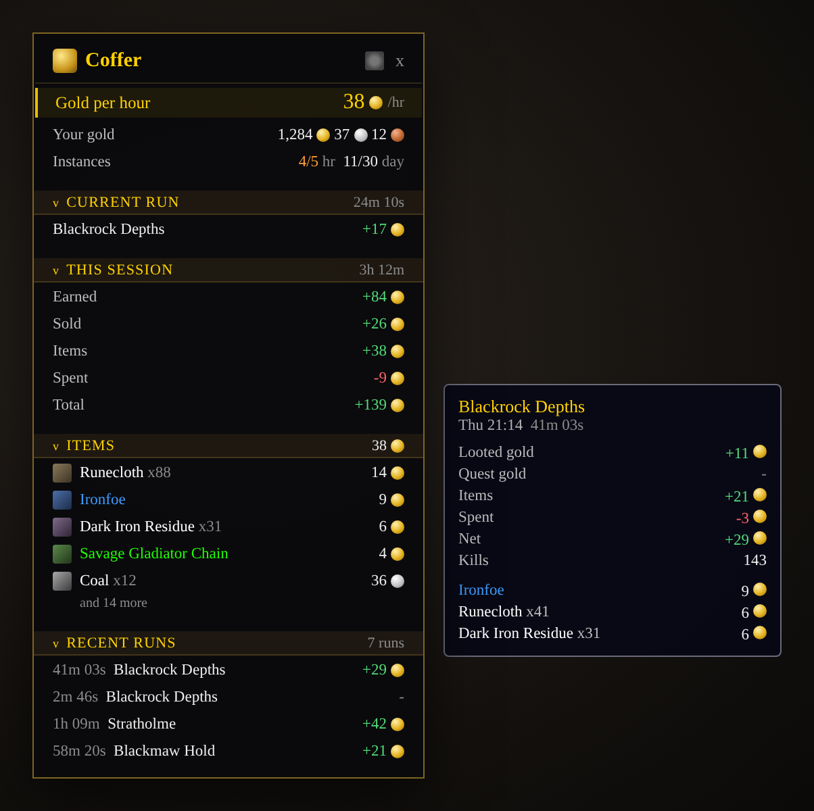

# Coffer

A gold-per-hour, loot and dungeon-run tracker for **World of Warcraft: Forever**. It
takes the farming panel style of Fojicore's `Campfires` / `GPH` and the tracking
techniques and instance lockout tracker of
[KiwiFarm](https://github.com/michaelnpsp/KiwiFarm), and puts them in one addon.



> Rendered mockup of the panel's layout (from `UI.lua`) with a run tooltip, not a live
> in-game screenshot. In-game fonts and exact spacing differ slightly; numbers are sample
> data.

## What it tracks

- **Gold per hour**: (looted gold + quest gold + value of looted items) per hour,
  counting **online time only**. Time spent logged off doesn't dilute it.
- **This session**: looted and quest gold, vendor and auction house sales, the value
  of items you still have, spending and net total, kept across logouts until you
  start a new session.
- **Items**: everything you loot or craft, with stack counts and value. Values use
  TradeSkillMaster or Auctionator market prices when installed, and never go below
  vendor price, since a vendor will always buy the item. Soulbound items fall back to
  vendor price automatically. A vendor-only mode is available.
- **Current run / recent runs**: every dungeon or raid visit becomes a run with
  duration, gold, items, spending and kills. Dying and running back, or a `/reload`
  mid-dungeon, continues the same run instead of splitting it.
- **Instance lockouts**: how many instances you've used this hour and today against
  the Classic limits (5 per hour, 30 per day, shared across your account), plus a
  countdown to the next free slot once you hit the cap.

Hover anything for details: items show their tooltip (shift-click links them in chat),
runs show a full breakdown with their best drops, and the session, gold-per-hour and
instances rows explain their numbers.

## How it compares

| | Fojicore GPH | KiwiFarm | Coffer |
|---|---|---|---|
| Always-on panel with collapsible sections | yes | text block | yes |
| Per-run history | yes | no | yes, with per-run tooltips |
| Instance lockout tracker (hour/day) | no | yes | yes, account-wide |
| Item value: auction with vendor floor | vendor | configurable | yes (or vendor-only) |
| Online-time-only rate | ? | yes | yes |
| Runs survive deaths and `/reload` | ? | n/a | yes |
| Kill counts | no | yes | per session and per run |
| Built for Forever's client (C_Item APIs, secret values) | - | yes | yes |

## Install

Forever has its **own** install folder, `_forever_`. Addons in `_retail_` or
`_classic_era_` won't load in Forever.

1. Download the ZIP from GitHub (green **Code** button, then **Download ZIP**).
2. Extract it, and rename the folder from `Coffer-main` to `Coffer`.
3. Move it to `World of Warcraft\_forever_\Interface\AddOns\Coffer`.
4. Restart the game and make sure **Coffer** is ticked in the AddOns list at character
   select.

## Usage

- `/coffer`: show or hide the panel. It's also in the addon menu by the minimap.
- Gear icon: lock the panel, switch item valuation, re-price items, start a new
  session, clear run history.
- Right-click **THIS SESSION**: start a new session (run history is kept).
- Right-click an item to stop counting it, if something that wasn't loot got in.
- Click a section header to collapse it. Coffer remembers which sections you
  collapsed and whether the panel is shown.
- `/coffer help` lists the commands: `reset`, `lock`, `unlock`,
  `value auction|vendor`, `reprice`, `clearruns`, `debug`.

## How the numbers are worked out

Coffer reads each source from the event that carries it rather than guessing from
changes in your gold:

- **Looted gold** comes from `CHAT_MSG_MONEY`, parsed with Blizzard's own localized
  `GOLD_AMOUNT`/`SILVER_AMOUNT`/`COPPER_AMOUNT` templates. That covers "You loot ..."
  and "Your share of the loot is ...", and guild-bank deposits in parentheses are
  ignored.
- **Quest gold** comes straight from `QUEST_TURNED_IN`'s money argument.
- **Your loot** is matched against Blizzard's localized `LOOT_ITEM_SELF` templates.
  Other players' loot uses a different template ("X receives loot"), so it can never
  be counted as yours, and Forever's two-part character names don't matter.
- **Items you buy aren't loot.** The game announces auction house purchases
  (collected from the mailbox), vendor purchases, trades and bank withdrawals with the
  same "You receive item: ..." line it uses for quest rewards. Coffer ignores items
  that arrive while one of those windows is open.
- **Spending** is any drop in your gold, including auction house and vendor purchases,
  except gold mailed or traded away, which isn't spending.
- **Selling and crafting move value, they never count it twice.** An item you loot
  or craft counts at its value while you have it. When you sell it, it leaves Items and
  the gold you actually got counts under Sold instead. When you craft with it, it
  leaves Items and the crafted item counts instead. So 10 Runecloth looted shows as
  their value, and once sold, as what they really sold for.
  - Vendor sales: items that leave your bags while a vendor is open (right-click,
    dragging, the sell-junk button and auto-sell addons alike).
  - Auction house sales: read from the "Auction successful" mail's invoice (item,
    quantity, gold) when you collect it. Gold mailed by your alts isn't a sale, and an
    outbid refund gives back the bid counted as spent.
  - Crafting: the "You create: ..." line, with the looted materials that left your bags
    around it.
  - Selling or crafting with things you didn't loot this session (yesterday's farm,
    materials from your bank) has nothing to move, so it's simply a gain.
  - Banking, mailing or posting an item on the AH doesn't remove it: you still have
    it, or will once it sells.

Totals: **Earned** (looted + quest gold), **Sold**, **Items** (value of loot and crafts
you still have), **Spent**, and **Total** (all of it minus Spent). Gold per hour is
everything except Spent, per hour online.

**Kills and lockouts:** on Forever's client, addons get `UNIT_DIED` with enemy GUIDs as
"secret" values, and can't use the combat log. KiwiFarm works the same way. Kills
count only inside instances, because in the open world there's no way to tell your
kills from other players'. An instance uses a lockout slot on your first kill inside
it. Resets are read from the system message, and logging out (not `/reload`) resets
every instance you used, just as the game does.

## Testing without a WoW client

`tests/` runs the addon under [fengari](https://fengari.io), a Lua VM in JavaScript,
against a mock of Forever's client. The mock is strict where the real client is:

- classic globals Forever lacks (`GetItemInfo`, `GetCoinTextureString`) don't exist
- secret values behave like real ones (typed as strings, but any use errors)
- registering the combat log is forbidden
- frames start shown and fire `OnShow` only on a real change
- calling a widget method that doesn't exist is an error
- if Coffer reports any error through its own error handling, the run fails

On top of that it plays a full farming session and makes 124 checks on the numbers,
including `/reload`s, logout and login with saved data carried over, and a death
mid-dungeon.

```bash
cd tests
npm install
npm test
```

The suite has been checked by reintroducing past bugs one at a time and confirming each
one fails it: bare `GetItemInfo`, missing secret-value guards, a panel ticker that never
starts, runs split by a death, wall-clock session time, vendor sales counted as income,
mail counted as spending, layout height drifting from placement, and open-world kills.

## Known limitations

- Lockout limits follow Classic rules (5 per hour, 30 per day), as KiwiFarm applies
  them to Forever. If Forever's actual limits differ, they're two constants at the top
  of `Lockouts.lua`.
- Open-world kills aren't counted (see above).
- Gold received by mail (other than auction sales) or trade isn't counted as income,
  since it isn't farming income.
- Materials from before the session count as free when you craft with them, so a
  craft shows its full value. Materials bought this session are already in Spent.
